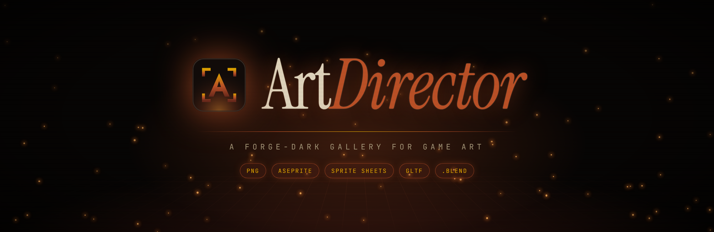
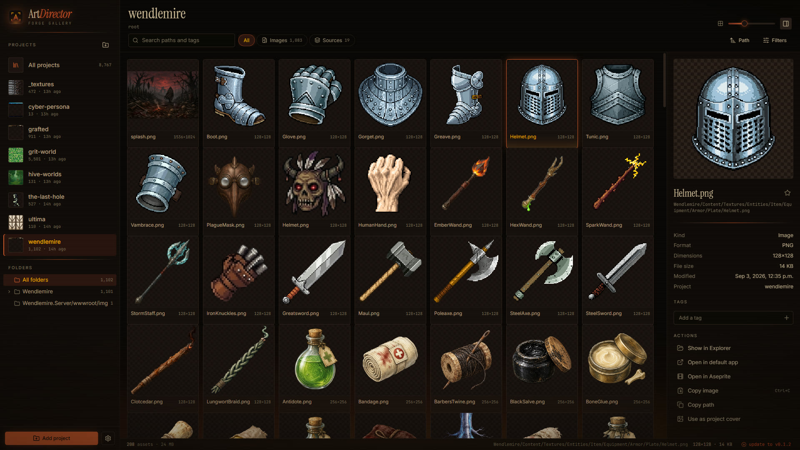
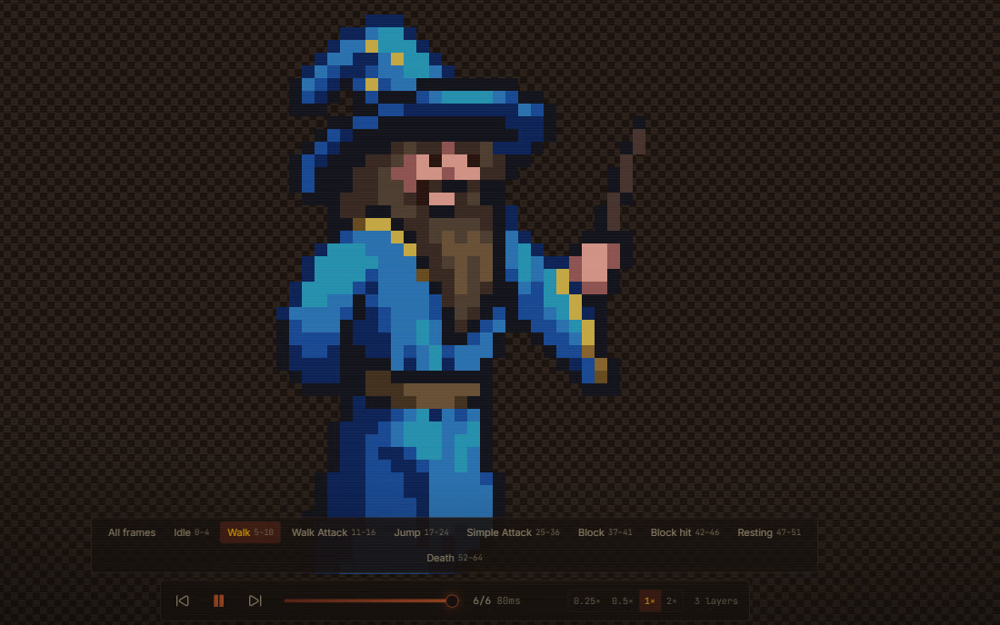
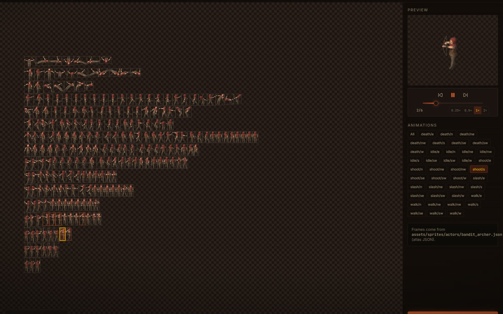
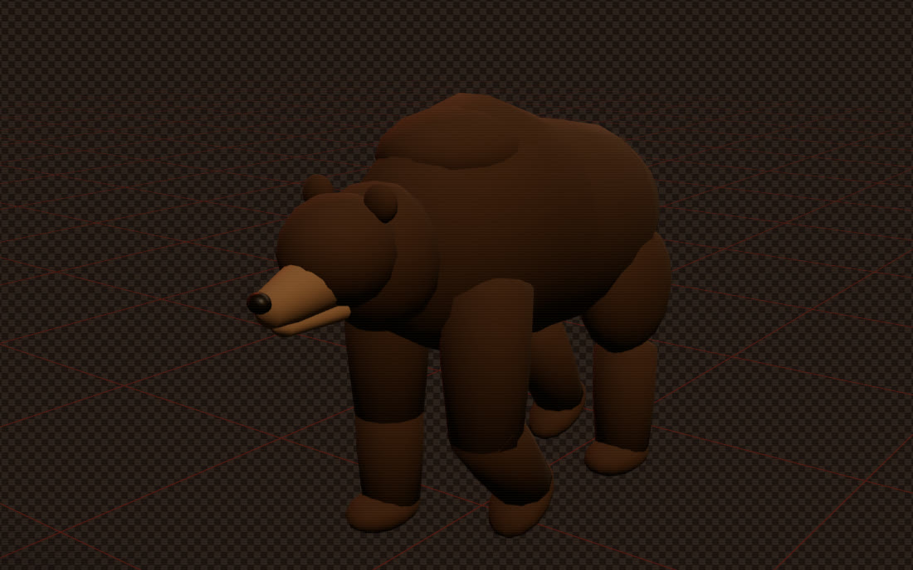

<p align="center">
  
</p>

<p align="center">
  <a href="https://github.com/neonparticle/ArtDirector/releases/latest"></a>
  
  
</p>

A desktop gallery for the art inside your game projects. Point it at your repos and it indexes every sprite, sheet, Aseprite file and 3D model into one fast, keyboard-driven window.



<table>
  <tr>
    <td></td>
    <td></td>
    <td></td>
  </tr>
  <tr>
    <td align="center"><sub>Aseprite tags &amp; playback</sub></td>
    <td align="center"><sub>Sprite sheet animations</sub></td>
    <td align="center"><sub>.blend / glTF models</sub></td>
  </tr>
</table>

## Install

Grab `ArtDirector_<version>_x64-setup.exe` from [Releases](https://github.com/neonparticle/ArtDirector/releases/latest). After that the app updates itself; new versions show up in the status bar.

The installer isn't code-signed, so SmartScreen asks once: **More info → Run anyway**.

## What it does

| Kind | Files | Viewer |
| --- | --- | --- |
| Images | `png jpg webp gif svg bmp tga` | Nearest-neighbor zoom, pixel grid, swappable backdrops |
| Aseprite | `ase aseprite` | Layers composited natively; tags, frame timings, playback |
| Sprite sheets | PNG + TexturePacker / Aseprite JSON, or plain grids | Every animation playable; grid layouts editable and saved |
| 3D | `glb gltf fbx obj` | Orbit, wireframe, lighting, animation clips |
| Blender | `blend` | Exported through Blender in the background, then viewed as 3D |
| Sources | `psd afphoto kra xcf` | Indexed; open in their app |

- **Library**: add folders as projects. Indexing runs in Rust, respects `.gitignore`, skips build output and re-indexes on file changes.
- **Find**: search paths and tags; filter by kind, tag, favorites and minimum size; sort by path, name, date, size or dimensions; hide duplicates.
- **Organize**: favorites, tags, project covers.
- **Hand off**: copy image to clipboard (alpha kept), reveal in Explorer, open in Aseprite, Blender or the default app.

## Keys

| Key | Action |
| --- | --- |
| Arrows, Home, End | Move selection, or previous/next asset in the viewer |
| Enter, Space | Open |
| Esc | Close viewer |
| F | Favorite |
| I | Toggle info panel |
| Ctrl+C | Copy image |
| Space, `,` `.` | Play/pause, step frame (Aseprite, sheets) |
| `0` `1` `+` `-` | Fit, 1:1, zoom |

## Optional tools

- **Blender** for `.blend` previews. Auto-detected from `PATH` and Program Files, or set in Settings.
- **Aseprite** for "Open in Aseprite".

## Develop

Needs Node 22+, stable Rust and WebView2.

```sh
npm install
npm run tauri dev     # app with hot reload
npm run check         # Biome lint + format check
npm test              # Rust tests
npm run bindings      # regenerate src/lib/bindings.ts after changing commands
npm run tauri build   # NSIS installer in src-tauri/target/release/bundle
```

Tauri 2 · Rust (SQLite, rayon, notify, image, asefile) · React 19 · three.js / R3F · zustand · Tailwind 4

## Releases

Every push to `main` runs [`release.yml`](.github/workflows/release.yml): lint, test, build, sign, then publish `v<major>.<minor>.<run number>` with the `latest.json` the updater reads. Bump major/minor in `src-tauri/tauri.conf.json`. Signing uses the `TAURI_SIGNING_PRIVATE_KEY` and `TAURI_SIGNING_PRIVATE_KEY_PASSWORD` repo secrets.
